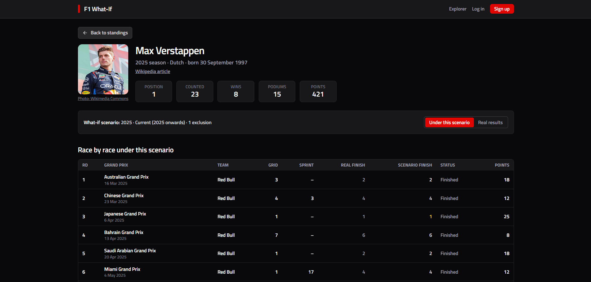

# F1 What-If

Re-score any Formula 1 season under a different points system and see how the championship would have ended. Choose a season, pick a points system, drop drivers or races, count only a driver's best results, and compare the result with what really happened.

**Live demo:** https://f1-what-if.vercel.app
(The backend runs on a free tier and sleeps when idle, so the first request after a pause can take several seconds.)



## What you can do

- **Re-score a season** from 1961 on with presets such as the current system, older ones and the 2021 sprint points, or with your own settings.
- **Change the rules:** include or exclude sprints, count only the best _N_ results, exclude drivers (everyone behind them moves up) or whole races.
- **See the difference:** places gained or lost against the real standings, with the same tie-breaks as the real championship (countback).
- **Open a driver:** season totals, every race result, and a photo from Wikimedia Commons. Opened from the explorer, the page shows real and scenario results side by side, with excluded races muted and dropped results struck through.
- **Save and share:** sign up with a username, save scenarios, reopen them later, and share one through a public link that works without an account.

## How it works

```
Browser ── Angular app (Vercel) ──/api──► Spring Boot API (Northflank) ──► MySQL-compatible DB (TiDB Cloud)
                                                    ▲
                              Jolpica F1 API ── importer (run on demand)
```

- **Scoring engine:** plain Java without Spring, so it is easy to test. Policies: `NONE`, `HALF_1980` (half points for shortened races) and `TIERED_2022` (tiered points by race distance). The six known half-point races since 1961 are stored by round. Countback tie-breaks, `countBest` and driver exclusions are part of the engine.
- **Backend:** Spring Boot 4 on Java 25. Spring Security with JWT (HS256, 60 minutes, no refresh) and BCrypt, JPA/Hibernate, Flyway migrations, Caffeine caches for standings, rulesets and reference data, Springdoc OpenAPI, and AOP for rate limiting and request timing.
- **Frontend:** Angular 22 (standalone, zoneless, signals), NgRx (Store, Effects, `createFeature`), Tailwind CSS 4. Settings changes are debounced and a newer request cancels an older one, so a slow response never replaces a newer result.
- **Data:** race results are imported from the [Jolpica F1 API](https://github.com/jolpica/jolpica-f1) (the Ergast successor). Driver photos come from Wikimedia Commons only.

## Repository layout

| Folder                | Content                                                                           |
| --------------------- | --------------------------------------------------------------------------------- |
| `f1-whatif-backend/`  | Spring Boot API, Flyway migrations (`V1`–`V7`), Dockerfile, local database script |
| `f1-whatif-frontend/` | Angular app, unit tests (Vitest), end-to-end tests (Playwright, backend mocked)   |

More detail on the frontend structure and state handling is in [`f1-whatif-frontend/README.md`](f1-whatif-frontend/README.md).

## Run it locally

Requirements: Java 25, Node.js 22.12 or newer, MySQL. No Docker needed.

**1. Database** (once, as an admin user):

```
mysql -u root -p < f1-whatif-backend/scripts/local-db-setup.sql
```

**2. Backend** (port 8080; Flyway creates the tables on the first start):

```
cd f1-whatif-backend
.\mvnw spring-boot:run        # Windows
./mvnw spring-boot:run            # macOS / Linux
```

**3. Data.** The database starts empty. Import seasons with the `import` profile; it starts on a random port, so it can run while the API is up. PowerShell example:

```
$env:SPRING_PROFILES_ACTIVE = "import"
$env:APP_IMPORT_FROM = "2018"
$env:APP_IMPORT_TO = "2024"
$env:APP_IMPORT_SKIP_EXISTING = "true"
.\mvnw spring-boot:run
```

The importer waits between requests and stays under the API's hourly limit, so a full import from 1961 takes a while. With `skip-existing=true` a rerun continues where it stopped.

**4. Frontend** (port 4200; `/api` is forwarded to the backend):

```
cd f1-whatif-frontend
npm install
npm start
```

## Tests

```
cd f1-whatif-backend && .\mvnw test

cd f1-whatif-frontend
npm test                  # unit tests
npm run e2e:install       # once: downloads the Playwright browser
npm run e2e               # end-to-end tests
```

## Configuration (backend)

| Variable                                                       | Purpose                                                                   | Default                  |
| -------------------------------------------------------------- | ------------------------------------------------------------------------- | ------------------------ |
| `DB_URL`, `DB_USER`, `DB_PASSWORD`                             | Database connection                                                       | local MySQL              |
| `JWT_SECRET`                                                   | Signing key; required in production, the app refuses to start without it  | dev-only value           |
| `CORS_ALLOWED_ORIGINS`                                         | Allowed browser origins                                                   | `http://localhost:4200`  |
| `APP_RATE_LIMIT_ENABLED`                                       | Turn rate limiting on or off                                              | `true`                   |
| `APP_RATE_LIMIT_TRUST_FORWARDED_FOR`                           | Read the visitor's address from `X-Forwarded-For` (needed behind a proxy) | `false`                  |
| `APP_RATE_LIMIT_PROXIES_TO_SKIP`                               | Entries to skip at the end of that header                                 | `0`                      |
| `APP_IMPORT_FROM`, `APP_IMPORT_TO`, `APP_IMPORT_SKIP_EXISTING` | Importer range and resume (import profile only)                           | 1961, this year, `false` |

Production uses the `prod` profile (set in the Dockerfile).

## Deployment

| Part     | Host                                                                                                |
| -------- | --------------------------------------------------------------------------------------------------- |
| Frontend | Vercel; `vercel.json` forwards `/api/*` to the backend and falls back to `index.html`               |
| Backend  | Northflank, built from `f1-whatif-backend/Dockerfile` (layered image, small-container JVM settings) |
| Database | TiDB Cloud Starter (MySQL compatible)                                                               |

Deploy the backend first: Flyway runs new migrations on startup, and the API's request fields may change between versions.

## API overview

The full, interactive description is generated by Springdoc (`/swagger-ui.html` on a running backend).

| Area      | Endpoints                                                                                                                               |
| --------- | --------------------------------------------------------------------------------------------------------------------------------------- |
| Reference | `GET /api/seasons`, `/api/seasons/{year}/races`, `/api/seasons/{year}/drivers`, `/api/rulesets`, `/api/rulesets/{code}`                 |
| Standings | `GET /api/seasons/{year}/standings` (ruleset, sprints, `countBest`, exclusions)                                                         |
| Drivers   | `GET /api/seasons/{year}/drivers/{id}/results`, `/scenario-results`, `GET /api/drivers/{id}/photo`                                      |
| Accounts  | `POST /api/auth/register`, `/login`; `GET /api/auth/me`                                                                                 |
| Scenarios | `/api/scenarios` (create, list, update, delete, standings), `POST` and `DELETE /api/scenarios/{id}/share`, `GET /api/shared/{publicId}` |

## Design decisions

- **Scoring without a framework:** the rules are the part most likely to be wrong, so they live in plain Java with focused unit tests, including the known edge cases such as the 1984 Monaco half points.
- **Rounds, not database ids, in URLs and saved scenarios:** links and scenarios stay valid if the data is re-imported.
- **Token only where needed:** the interceptor attaches the JWT just to `/api/auth/me` and `/api/scenarios/**`, because the backend rejects an expired token even on public endpoints.
- **Rate limiting in an aspect:** logins are limited to 10 per minute and sign-ups to 5 per hour per visitor address, kept in memory (run a single instance). Addresses are never logged.
- **Free-tier friendly:** caching of standings and reference data, a small connection pool and a JVM tuned for startup keep cold starts short.

## Known limits

- Accounts use a username only, so there is no password recovery.
- Tokens last 60 minutes and are not refreshed; after that the user logs in again.
- Rate-limit counters reset when the backend restarts.

## License

[MIT](LICENSE) © 2026 Asad Sardar

## Data and credits

Race data: [Jolpica F1 API](https://github.com/jolpica/jolpica-f1). Driver photos: Wikimedia Commons, under their respective licenses. This is an unofficial fan project, not affiliated with Formula 1.
